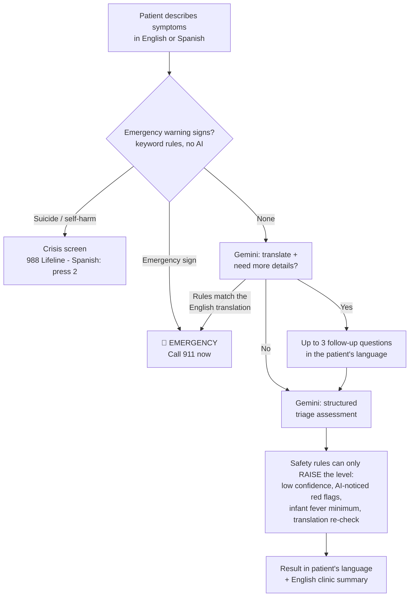

# 🪞 Mirror Triage

**ITAI 2372 · Module 03 · AI in Healthcare** 

> A bilingual (English / Spanish) AI symptom-triage app that tells patients **how soon** to seek care, in their own language — and *mirrors* the same case as an English summary for the clinic.

🔗 **Live demo:** _add your Streamlit link here after deploying_
🖼️ **Screenshots:** _add images to `docs/` and link them here_

> ⚠️ **Student project, not medical advice.** Mirror Triage cannot diagnose anyone and is not a medical device. In an emergency, call **911**.

---

## In plain English (for non-technical readers)

**The problem.** More than 25 million people in the U.S. have limited English proficiency, which is linked to worse access, safety, and outcomes in healthcare. At the same time, millions of people now ask AI chatbots about their symptoms before deciding whether to see a doctor — and research published in 2026 shows those chatbots can badly misjudge emergencies.

**What Mirror Triage does.** A patient types their symptoms in English or Spanish. The app:

1. **Checks for emergency warning signs first** using a fixed checklist based on U.S. public-health guidance — no AI involved, so it behaves the same way every time.
2. **Asks a few follow-up questions** if the description is unclear (using Google's Gemini AI).
3. **Gives one of four triage levels** — Emergency, Urgent, See a doctor, or Home care — with advice in the patient's language.
4. **Mirrors the case in English** for the clinic, so the doctor or nurse understands what the patient said.

**Why "Mirror"?** One assessment, reflected two ways: plain guidance for the patient in their language, and a clinical summary in English for the care team.

**What it is not.** It does not diagnose disease, prescribe treatment, or replace a doctor, nurse, or interpreter.

---

## The innovation and the research behind it

This project responds to a **recent AI-driven healthcare innovation: patient-facing AI symptom triage**, together with **AI medical interpretation**.

| Research finding (2026) | What it means |
|---|---|
| 32% of U.S. adults used AI chatbots for health information in the past year; many did so to decide whether to see a provider (KFF poll, cited in CARE-Bench). | Patient-facing AI triage is already in everyday use. |
| In a structured test, **ChatGPT Health under-triaged 51.6% of clear emergency cases** and over-triaged 64.8% of non-urgent ones (Ramaswamy et al., *Nature Medicine*, 2026). | AI can miss emergencies — the most dangerous kind of error. |
| An LLM gave accurate triage advice on complete case descriptions, but accuracy **dropped sharply when real people described their own symptoms** (randomized study, *Nature Medicine* 32, 2026). | People leave out key details; the AI needs to ask. |
| An AI interpreter (LingualAI) matched certified interpreters on **medical terminology and meaning** in English–Spanish visits, but not on clarity; authors recommend keeping a human interpreter involved for high-stakes conversations (*npj Health Systems*, May 2026). | AI translation helps, but should support — not replace — people. |
| A 2026 randomized trial (NCT07728513) is testing an LLM interface that **asks clarifying questions first** and answers in a **fixed template** (possible conditions, likelihood, triage level with reasoning). | Structured, question-first design is an active research direction. |

### How Mirror Triage answers each finding

| Finding | Mirror Triage design feature |
|---|---|
| AI under-triages emergencies | **Rules-first safety net** (`red_flags.py`): emergency warning signs trigger "call 911" *before* any AI runs. Safety rules can only make a result **more** urgent, never less. |
| Accuracy drops with real users' incomplete descriptions | **Follow-up questions**: Gemini asks up to 3 targeted questions before deciding. |
| Free-text AI answers are unreliable to parse | **Structured output**: Gemini must fill in a fixed JSON form (level, confidence, possible causes, advice), validated with Pydantic. |
| AI translation works best with a human involved | **English clinic summary** that recommends offering a qualified interpreter for higher-stakes conversations. |
| AI can be uncertain | **Low confidence → round up**: if Gemini says it is unsure, the result moves up one level. |
| Spanish speakers may be treated differently | **Cross-language test**: every test case exists in English *and* Spanish, and the evaluation checks that both get the same result. |

---

## How it works



### The four triage levels

| Level | Meaning |
|---|---|
| 🚨 **Emergency** | Call 911 or go to the emergency room now |
| ⚠️ **Urgent** | Get medical care today, within hours |
| 🩺 **Primary care** | See a doctor in the next few days |
| 🏠 **Self-care** | Home care, with warning signs to watch |

### Where the emergency warning signs come from

The keyword rules in `red_flags.py` (English and Spanish) are based on:

- **MedlinePlus** (U.S. National Library of Medicine) — *Recognizing medical emergencies*
- **CDC** — stroke signs (**BE FAST**: balance, eyes, face, arms, speech, time)
- **American Academy of Pediatrics** — a baby under 3 months with a fever of **100.4 °F (38.0 °C)** or higher needs a doctor right away
- **CDC Hear Her** — urgent maternal warning signs (bleeding or severe belly pain during pregnancy)
- **988 Suicide & Crisis Lifeline** — Spanish speakers can call 988 and press 2, or text **AYUDA** to 988

---

## Evaluation

`test_cases.csv` contains **12 made-up situations, each written in English and Spanish (24 cases)**: 4 emergencies, 3 urgent, 3 primary-care, and 2 self-care. No real patient data is used. The cases are intentionally different from the examples inside the prompt, so the test is fair.

`evaluate.py` measures:

- **Exact accuracy** — the level matches the expected level
- **Under-triage rate** — the app was *less* urgent than it should be (the most dangerous error)
- **Over-triage rate** — the app was *more* urgent than needed (safer, but costly)
- **Emergency recall** — emergencies correctly sent to "Emergency"
- **Cross-language agreement** — English and Spanish versions of the same case got the same result
- **Gemini alone vs. after safety rules** — what the safety layer adds

### Results — safety rules alone (offline, no AI)

Run with `python evaluate.py --rules-only`:

- The keyword rules alone caught **5 of 8 emergencies** with **0 false alarms** on the 24 cases.
- One instructive gap: the Spanish case *"Me duele el pecho…"* matches the Spanish chest-pain list, but the English wording *"My chest has been hurting…"* does not match the English list. Keyword rules are brittle, which is exactly why the AI steps exist — and why the two layers are combined.

### Results — full app (rules + Gemini)

Run with `python evaluate.py` (needs an API key). Paste the table from `results/summary.md` here:

| Metric | Result |
|---|---|
| _run `python evaluate.py` and paste results here_ | |

---

## Safety, ethics, and privacy

- **Disclaimers everywhere.** The app states on every screen that it is a student demo, not medical advice, and to call 911 in an emergency.
- **Fixed safety text.** Emergency instructions, the crisis-line information, and disclaimers are written by a person (`ui_text.py`), never generated by the AI.
- **Prompt-injection guard.** Patient text is wrapped in `<patient_text>` tags, and Gemini is told to treat it only as symptoms — never as instructions.
- **No API keys on GitHub.** The key is read from an environment variable or Streamlit secrets. `.gitignore` blocks `secrets.toml`.
- **Privacy.** Users are told not to enter names or personal details. Requests are sent with `store=False`. However, on Gemini's **free tier, Google may use requests to improve its products** (per Google's pricing page), so **only made-up symptoms should be used** with this demo.
- **Bias check.** Every case is tested in both languages to detect whether Spanish speakers get different results.

### Known limitations

- **Not clinically validated.** Twenty-four invented test cases are a sanity check, not clinical evidence. A real tool would need clinician review, much larger validation, and regulatory review.
- **Keyword rules don't understand negation.** "No chest pain" still triggers the chest-pain rule. This is a deliberate, safe-side trade-off: a false alarm costs a phone call; a missed emergency can cost a life.
- **Keyword lists miss some phrasings** (see the evaluation above). The AI steps and the translation re-check reduce, but cannot eliminate, this gap.
- **LLMs can be wrong or inconsistent.** The same input can produce different answers on different runs.
- **Two languages only.** Burmese, Vietnamese, Chinese, and others are planned future work.

---

## Run it yourself

### 1. Requirements

- **Python 3.11 or newer.**
  ⚠️ *On Windows laptops with ARM chips (e.g., Snapdragon X), install the **x64 (64-bit) version** of Python from python.org. Streamlit depends on `pyarrow`, which does not publish native Windows ARM64 wheels.*
- A free **Gemini API key** from [Google AI Studio](https://aistudio.google.com/apikey).

### 2. Install

```bash
git clone <repo-url>
cd <the folder that contains app.py>
python -m venv .venv
.venv\Scripts\activate          # Windows   (macOS/Linux: source .venv/bin/activate)
pip install -r requirements.txt
```

### 3. Add your API key (never put it in the code)

**Windows:** search "Environment Variables" → **User variables** → **New** → name `GEMINI_API_KEY`, value = your key → OK. Then open a **new** terminal.

**macOS/Linux:** `export GEMINI_API_KEY="your-key"`

### 4. Start the app

```bash
streamlit run app.py
```

### 5. Run the tests and evaluation

```bash
pip install pytest
python -m pytest                 # 34 offline tests - no API key needed
python evaluate.py --rules-only  # offline check of the safety rules
python evaluate.py               # full evaluation with Gemini
```

### Deploy online (Streamlit Community Cloud, free)

1. Push this folder to a public GitHub repository.
2. Go to [share.streamlit.io](https://share.streamlit.io), click **Create app**, and choose your repository, branch, and the path to `app.py` as the main file (for example `ITAI-2372-Module-03-Mirror-Triage/app.py` if the project sits in a subfolder).
3. Under **Advanced settings → Secrets**, paste: `GEMINI_API_KEY = "your-key"`
4. Deploy, then add the link to the top of this README.

---

## Project structure

| File | What it does |
|---|---|
| `app.py` | The Streamlit web app: intake form, follow-up questions, results screen |
| `triage_pipeline.py` | The decision logic that combines the rules and the AI (shared by the app and the evaluation) |
| `red_flags.py` | Emergency warning-sign rules in English and Spanish, with their public-health sources |
| `gemini_client.py` | Calls Gemini with structured output and validates the answers with Pydantic |
| `prompts.py` | Every instruction given to Gemini, in one readable place |
| `levels.py` | The four triage levels and the "round up when unsure" helper |
| `ui_text.py` | All on-screen text in English and Spanish |
| `evaluate.py` | Scores the app on the test cases |
| `test_cases.csv` | 24 invented test cases (12 English/Spanish pairs) |
| `tests/` | 34 automated tests that run offline with a fake AI client |
| `.streamlit/secrets.toml.example` | Template showing where the API key goes (contains no real key) |

**Tech stack:** Python · Streamlit · Google Gemini API (`gemini-3.8-flash`, Interactions API with structured output) · Pydantic · pytest

**AI assistance:** As the assignment encourages, an AI assistant (Claude, by Anthropic) helped with design discussion, code, tests, and documentation. Design decisions, testing, and review are my own.

---

## References

1. KFF (2026) poll, and Costa-Gomes et al. (2026), as cited in *CARE-Bench: Benchmarking Patient-Facing LLM Triage* — https://arxiv.org/pdf/2608.03731
2. Ramaswamy et al. (2026). *ChatGPT Health performance in a structured test of triage recommendations.* Nature Medicine. Summarized by UCSF CODEX — https://codex.ucsf.edu/news/insights-codex-director-sumant-ranji-md-sfhm-analyzing-new-research-llms-and-patient-triage
3. *Reliability of LLMs as medical assistants for the general public: a randomized preregistered study.* Nature Medicine 32, 609–615 (2026) — summarized in reference 2
4. LingualAI vs. certified medical interpreters, *npj Health Systems* (May 2026) — https://digitalcommons.library.tmc.edu/uthshis_docs/837
5. ClinicalTrials.gov NCT07728513, *Improving AI-Assisted Medical Diagnosis and Triage by the General Public* — https://clinicaltrials.gov/study/NCT07728513
6. MedlinePlus, *Recognizing medical emergencies* — https://medlineplus.gov/ency/article/001927.htm
7. CDC, *Signs and Symptoms of Stroke* — https://www.cdc.gov/stroke/signs-symptoms/index.html
8. American Academy of Pediatrics, *Fever: When to Call the Pediatrician* — https://www.healthychildren.org/English/health-issues/conditions/fever/Pages/When-to-Call-the-Pediatrician.aspx
9. CDC Hear Her, *Urgent Maternal Warning Signs* — https://www.cdc.gov/hearher/maternal-warning-signs/index.html
10. *The Spanish Subnetwork: Crisis support for people who speak Spanish* (988 Lifeline in Spanish) — https://www.cha.wa.gov/newsblog/2025/3/3/the-spanish-subnetwork-crisis-support-for-people-who-speak-spanish
11. Google, *Gemini API structured outputs* — https://ai.google.dev/gemini-api/docs/structured-output · *Pricing (free tier)* — https://ai.google.dev/gemini-api/docs/pricing

---

*Mirror Triage is a student project for learning purposes. It is not a medical device and does not replace a doctor, nurse, interpreter, or emergency services.*
