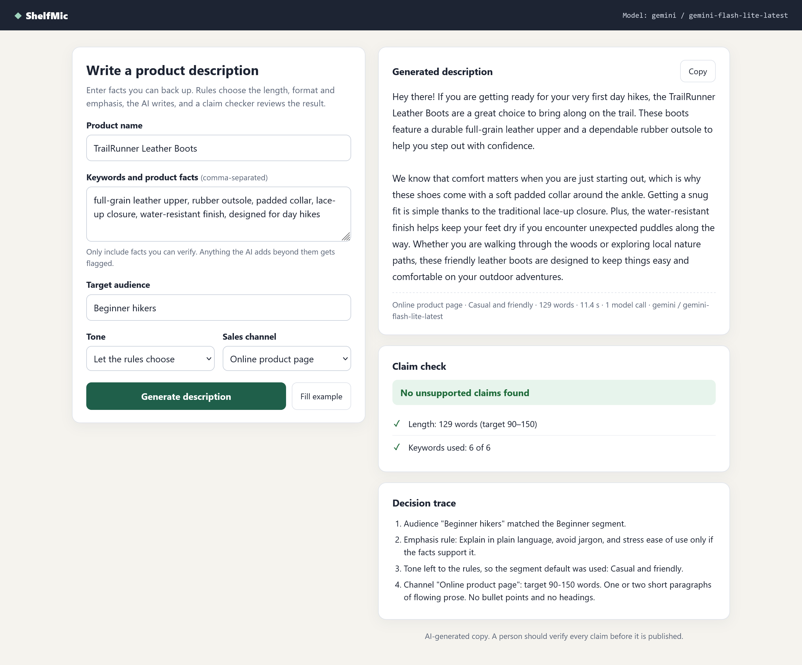
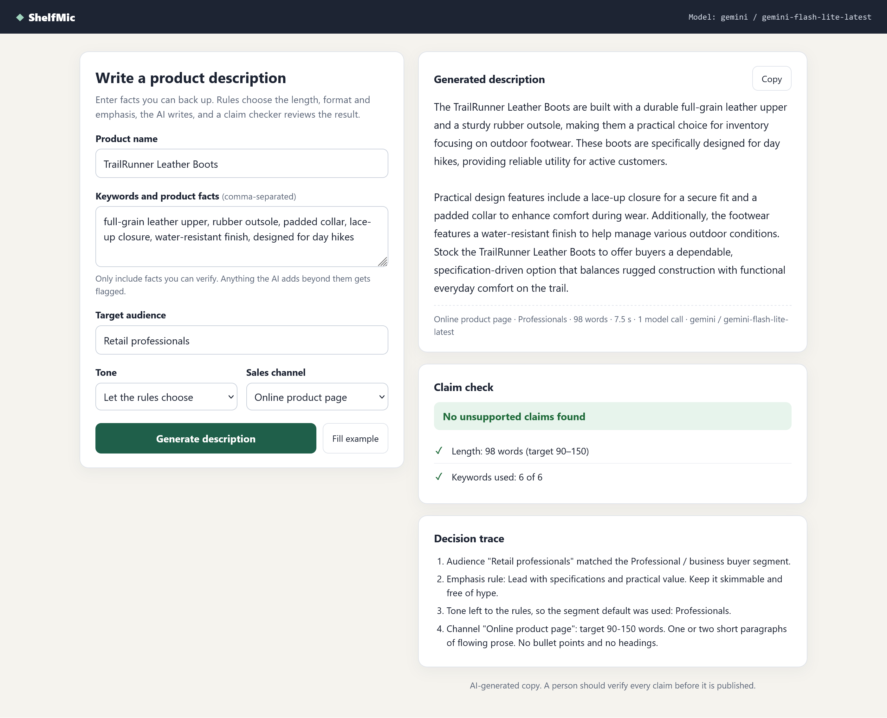
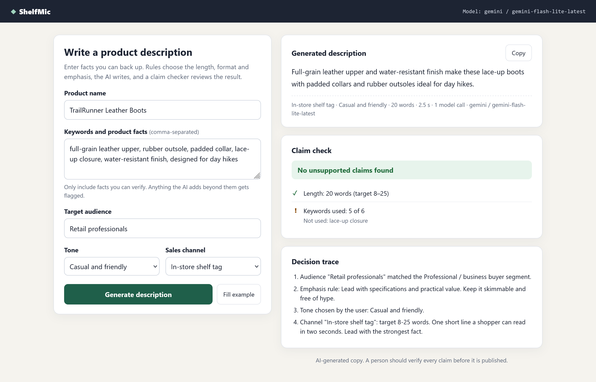

# ShelfMic: GenAI Product Description Generator

ITAI 2372, Module 06 (AI in Retail). A Flask app that turns a product name and comma-separated facts into product copy with Google Gemini, then checks the AI's work before a person publishes it.

## What it does

1. **Rules decide** (`generator.py`). The audience text is matched to a customer segment (Beginner, Professional, Budget, Gift, Outdoor, Young adult, or General). The segment sets what the copy emphasizes and a default tone. The sales channel (product page, marketplace bullets, social caption, shelf tag) sets length and format. Every choice is recorded in a **decision trace** shown on the page.
2. **The AI writes** (`llm.py`). Gemini receives only the approved facts plus the rules' instructions. The same prompt can be sent to a local Ollama model by changing one setting.
3. **The checker reviews** (`claims.py`). Plain Python flags claims the facts don't support (for example "waterproof" when you wrote "water-resistant"), numbers you never gave, hype ("best", "#1") and false urgency ("limited time"). If anything is flagged, the app asks the model for **one** rewrite and shows what was caught.

Core requirements: product name + comma-separated keywords → LLM → readable output.
Stretch goals: tone selection (plus "let the rules choose"), audience and channel personalization, rule-based decision layer, claim verification, and an evaluation script.

## Demo

Same six facts each time; one setting changes per screenshot. Model: `gemini-flash-lite-latest`.

**1. Beginner hikers, online product page.** The rules matched the Beginner segment and chose a casual tone: 129 words, 6 of 6 facts used, no flags.



**2. Audience changed to Retail professionals.** The rules switched to the Professional segment and tone, and the copy now speaks to a store buyer ("Stock the TrailRunner Leather Boots…"): 98 words, 6 of 6 facts, no flags.



**3. Channel changed to In-store shelf tag.** The length rule cut the copy to one 20-word line (target 8–25). The checker reports that "lace-up closure" was only partly used ("lace-up boots").



Full experiment results: [`results.md`](results.md). Report: [`REPORT.md`](REPORT.md).

## Files

| File | Purpose |
|---|---|
| `app.py` | Flask routes, input validation, error handling |
| `templates/index.html` | The page |
| `generator.py` | Decision rules, prompt builder, generate → check → rewrite pipeline |
| `llm.py` | Gemini and Ollama providers, behind one `generate_text()` function |
| `claims.py` | Rule-based claim checker |
| `evaluate.py` | Runs the controlled experiments and saves `results.csv` / `results.md` |
| `tests/test_app.py` | 16 offline tests (fake model, no key needed) |

## Run it (Windows PowerShell)

```powershell
cd module-06-product-description-generator
py -m venv .venv
.venv\Scripts\Activate.ps1
python -m pip install -r requirements.txt
python app.py
```

Open http://127.0.0.1:5000/

The key is read from `GEMINI_API_KEY` (or `GOOGLE_API_KEY`) in your environment. To use a `.env` file instead, copy `.env.example` to `.env` and fill it in. If Gemini says the model isn't available, set `GEMINI_MODEL=gemini-2.5-flash`.

If PowerShell blocks the activate script, run `Set-ExecutionPolicy -Scope Process Bypass` first.

## Run the experiments

```powershell
python evaluate.py          # all experiments (about 13 model calls plus rewrites)
python evaluate.py A F      # only some, to save free-tier quota
```

Then open `results.csv`, fill in the six 1–5 score columns from the assignment's rubric, and use `results.md` for the report.

## Run the tests

```powershell
python -m unittest discover tests
```

## Notes

- `.env` is git-ignored; the key never appears in code, URLs or error messages.
- Model output is shown as escaped text, never as HTML.
- This is a teaching prototype: Flask's development server, no login, CSRF protection or rate limiting.
